# SigNoz MCP Server — Architecture

## System Overview

```mermaid
flowchart TB

subgraph Startup["Server Initialization"]
    ENV["Env Vars: SIGNOZ_URL, SIGNOZ_API_KEY,<br/>LOG_LEVEL, TRANSPORT_MODE, MCP_SERVER_PORT,<br/>CLIENT_CACHE_SIZE, CLIENT_CACHE_TTL_MINUTES,<br/>OAUTH_ENABLED, OAUTH_TOKEN_SECRET, OAUTH_ISSUER_URL,<br/>OTEL_EXPORTER_OTLP_*"]
    ENV --> CFG["config.LoadConfig"]
    CFG --> VALIDATE["config.ValidateConfig"]
    VALIDATE --> LOG["log.New"]
    LOG --> OTEL["Init OpenTelemetry<br/>(Tracer, Meter; OTLP export only when configured)"]
    OTEL --> HANDLER["Handler with LRU clientCache"]
    HANDLER --> CHSCHEMA["dashboard.InitClickhouseSchema"]
    CHSCHEMA --> MCPSRV["NewMCPServer<br/>official MCP Go SDK v1.8.0"]
    MCPSRV --> REGISTER["Register all tool handlers<br/>(Org Overview, Metrics, TopMetrics, MetricUsage, Alerts, Dashboards, Services,<br/>QueryBuilderV5, Logs, LogPipelines, Docs, Traces)"]
    REGISTER --> MODE{"TransportMode?"}
end

subgraph StdioPath["Stdio Transport — Single Tenant"]
    MODE -->|stdio| STDIO["runStdio"]
    STDIO --> CTXFUNC["Seed API key, auth header,<br/>SigNoz URL, and client source"]
    CTXFUNC --> SETCTX_S["official Server.Run<br/>with StdioTransport"]
    SETCTX_S --> TOOL_S["Tool Handler Called"]
end

subgraph HTTPPath["HTTP Transport — Multi Tenant"]
    MODE -->|http| HTTP["HTTP Server<br/>/mcp + /healthz + /livez + /readyz + /oauth/* + /.well-known/*"]
    HTTP --> OTELWRAP["otelhttp.NewHandler<br/>(wraps entire mux)"]
    OTELWRAP --> REQ["Incoming HTTP Request"]
    REQ --> HEALTHCHECK{"Path?"}

    HEALTHCHECK -->|/livez| LIVE["200 OK — liveness only, no dependency checks"]
    HEALTHCHECK -->|/healthz| HC200["Legacy health check<br/>same strict status as /readyz"]
    HEALTHCHECK -->|/readyz| READY["200 when docs index is ready<br/>503 while docs index is warming"]
    HEALTHCHECK -->|/.well-known/*<br/>/oauth/*| OAUTHFLOW["OAuth 2.1 Endpoints<br/>(no auth required)"]
    HEALTHCHECK -->|/mcp| AUTH["authMiddleware"]

    AUTH --> CHAIN{"Resolver chain<br/>(first match wins)"}
    CHAIN -->|SIGNOZ-API-KEY header| APIKEYHDR["Forward as SIGNOZ-API-KEY"]
    CHAIN -->|Bearer sz1.* + OAuth enabled| SESSION["Session token: decode instance URL,<br/>allowlist, GET /api/v2/users/me (cached 30s)"]
    SESSION -->|rejected| EXPIRED["401 + WWW-Authenticate invalid_token"]
    CHAIN -->|Bearer encrypted token + OAuth enabled| OAUTHCTX["Decrypt → apiKey + signozURL"]
    CHAIN -->|other Bearer| RAWKEY["Forward as Authorization: Bearer"]
    CHAIN -->|none + env key| ENVKEY["Use config.APIKey"]
    CHAIN -->|none| CHALLENGE["401 + WWW-Authenticate<br/>resource_metadata URL"]

    AUTH --> URLCHECK{"SigNoz URL source?"}
    URLCHECK -->|OAuth token| FROMTOKEN["Instance URL named by the token"]
    URLCHECK -->|X-SigNoz-URL header| NORMALIZE["normalizeSigNozURL"]
    URLCHECK -->|env set| ENVURL["Use config.URL"]
    URLCHECK -->|none| NOURL["400 Bad Request"]

    subgraph URLValidation["URL Validation (normalizeSigNozURL)"]
        NORMALIZE --> SCHEME["Validate scheme (http/https only)"]
        SCHEME --> PATHCHECK["Reject path/query/fragment"]
        PATHCHECK --> LOCALHOST["Block localhost, 0.0.0.0, [::]"]
        LOCALHOST --> STRIPPORT["Strip default ports (80/443)"]
        STRIPPORT --> ORIGIN["Return canonical origin"]
    end

    ORIGIN --> SETCTX_H["Set credential (header + value) and signozURL into ctx"]
    APIKEYHDR --> SETCTX_H
    SESSION --> SETCTX_H
    OAUTHCTX --> SETCTX_H
    RAWKEY --> SETCTX_H
    ENVKEY --> SETCTX_H
    ENVURL --> SETCTX_H

    SETCTX_H --> TOOL_H["Tool Handler Called"]
end

subgraph OAuthFlow["OAuth 2.1 Flow (Stateless)"]
    direction TB
    DISC["Client: GET /.well-known/oauth-protected-resource<br/>GET /.well-known/oauth-authorization-server"]
    DISC --> REGCLIENT["POST /oauth/register<br/>{client_name, redirect_uris}"]
    REGCLIENT --> ENCID["client_id = encrypt(redirect_uris, name)"]
    ENCID --> AUTHPAGE["GET /oauth/authorize<br/>Browser opens, user sees form"]
    AUTHPAGE --> CHOOSE{"User picks"}
    CHOOSE -->|SigNoz sign-in| DISCOVER["POST step=discover: instance URL + email<br/>→ GET /api/v2/sessions/context?email&ref"]
    DISCOVER --> SIGNIN["Consent page: password form and/or SSO buttons<br/>SSO sets cookie signoz_mcp_sso_&lt;nonce&gt; = encrypt(pending authorization)"]
    SIGNIN -->|password| PWD["POST step=password<br/>→ POST /api/v2/sessions/email_password"]
    SIGNIN -->|SSO| IDP["Browser → IdP → SigNoz /api/v1/complete/*<br/>→ GET /oauth/sso-callback/&lt;nonce&gt;?accessToken&refreshToken&expiresIn"]
    IDP --> CORR["Cookie for this nonce required;<br/>decrypt pending authorization"]
    PWD --> SCODE["auth_code = encrypt(SigNoz session, client_id,<br/>redirect_uri, code_challenge)"]
    CORR --> SCODE
    CHOOSE -->|API key| SUBMIT["POST step=apikey: SigNoz URL + API key<br/>validated against /api/v1/service_accounts/me"]
    SUBMIT --> ENCCODE["auth_code = encrypt(api_key, signoz_url,<br/>client_id, redirect_uri, code_challenge)"]
    SCODE --> REDIRECT["302 Redirect to client<br/>with ?code=encrypted"]
    ENCCODE --> REDIRECT
    REDIRECT --> EXCHANGE["POST /oauth/token<br/>{code, code_verifier}"]
    EXCHANGE --> VERIFY["Decrypt code, verify PKCE,<br/>verify client_id + redirect_uri match"]
    VERIFY --> ISSUE["Session: access_token = sz1.&lt;b64url(instance URL)&gt;.&lt;SigNoz access token&gt;<br/>refresh_token = encrypt(SigNoz session)<br/>API key: both encrypt(api_key, signoz_url)"]
    ISSUE --> USE["Client uses access_token on /mcp"]

    REFRESH["POST /oauth/token<br/>{grant_type: refresh_token}"]
    REFRESH --> DECREF["Session: POST /api/v2/sessions/rotate<br/>API key: decrypt"]
    DECREF --> ISSUE
    REVOKE["POST /oauth/revoke"] --> DELSESS["DELETE /api/v2/sessions"]
end

subgraph GetClient["GetClient — Unified for Both Transports"]
    TOOL["Tool Handler"]
    TOOL --> TLOG["tenantLogger(ctx)"]
    TLOG --> READ["Read apiKey and signozURL from ctx"]
    READ --> MISSING{"Both present?"}

    MISSING -->|No| ERR["Return error"]
    MISSING -->|Yes| HASH["cacheKey = SHA256(apiKey + delimiter + signozURL)"]

    HASH --> LOOKUP{"clientCache LRU hit?"}
    LOOKUP -->|Yes| HIT["Return cached client"]
    LOOKUP -->|No| CREATE["Create new SigNoz client and cache it"]

    CREATE --> HIT
end

subgraph Cache["Bounded Cache (expirable LRU)"]
    LRU_C["clientCache<br/>maxSize: 256, TTL: 30min"]
end

subgraph APICall["SigNoz API Call"]
    CLIENT["SigNoz Client<br/>(otelhttp instrumented)"]
    CLIENT --> APIREQ["HTTP Request with SIGNOZ-API-KEY header"]
    APIREQ --> S1["SigNoz Instance 1"]
    APIREQ --> S2["SigNoz Instance 2"]
    APIREQ --> SN["SigNoz Instance N"]
end

TOOL_S --> TOOL
TOOL_H --> TOOL
HIT --> CLIENT

LOOKUP -.->|read/write| LRU_C
```

### SigNoz API client layers

`internal/client` is the only package that calls SigNoz. Every API call except credential
validation goes through one transport, the `doer` in `internal/client/doer.go`, which stamps the auth and custom headers, retries
replay-safe requests on transport errors and 429/502/503/504, and buffers each response under a
64 MiB cap. Requests reach the `doer` in one of two ways:

- **Generated client** (`internal/apiclient`): built by `make gen` with
  [skaff](https://github.com/SigNoz/skaff) from the operations in `skaff.yml` and the OpenAPI spec of
  the pinned SigNoz release. It builds paths, query strings, and request bodies. Calls go through
  `callAPI`, which also rejects a 2xx HTML page (a SigNoz version without the route, or an auth
  proxy's login page) with `ErrNonJSONResponse`. Generated files are never hand-edited; regenerate
  after bumping `SIGNOZ_SPEC_REF`, `SKAFF_VERSION`, or `skaff.yml`. The generated types carry the
  upstream field descriptions as `jsonschema` struct tags, so a tool that registers its input with
  `mcp.WithInputSchema[T]` over an embedded generated type (alerts, notification channels, saved
  views) advertises those descriptions with no hand-written copy.
- **Spec-derived files** (`tools/specgen/specgen.py`, also run by `make gen`): the dashboard input
  schemas in `internal/handler/tools/schemas/` (raw JSON Schema, because the Perses unions need
  `oneOf` with discriminators that struct reflection cannot express) and the
  `pkg/*/examples.generated.md` files that the `signoz://*/examples` resources embed, rendered
  from the request examples the spec publishes on each operation. `make gen-spec` regenerates
  them without skaff; `make gen-check` fails when any generated file is stale.
- **Hand-written requests** (`doRequest`): only for routes missing from the spec, today the two
  services endpoints. It shares `callAPI`'s response path, so it rejects a 2xx HTML page too.
  Query parameters the spec omits for a documented route, such as the Alertmanager filters of
  `GET /api/v1/alerts`, are appended to the generated request with a request editor. Credential
  validation builds its requests with the generated constructors but sends them outside the
  `doer`, because a credential check must not retry.

Both paths return the raw response body. Tools pass it through or parse only the fields they need,
so fields the spec doesn't model still reach clients. Request bodies go through the generated
`WithBody` methods with the bytes the tool built, and the generated enum `Valid()` helpers are
never called, so SigNoz stays the only validator.

### Field names in query tools

SigNoz owns field metadata. The query tools send a field name the caller gives in `groupBy`,
`selectFields`, or `orderBy` without a context or data type, and SigNoz resolves it against the
workspace's own field metadata; a name in several contexts defaults to resource. A caller who
writes a context prefix (`resource.`, `attribute.`, `span.`, or `log.`) gets that context. The
server keeps no field catalog of its own: a search with no `selectFields` sends no field list,
and SigNoz returns each row's complete record. Metrics are the one exception to bare names:
every metrics label is sent in attribute context, because SigNoz keeps resource and point
attributes in one labels set and a name with no context would read an intrinsic column instead.

## MCP Runtime and Transports

The runtime is `github.com/modelcontextprotocol/go-sdk` v1.8.0. The same
production catalog supports both lifecycle models on HTTP and stdio:

| Protocol era | Lifecycle and request identity |
|---|---|
| `2025-11-25` | The client performs `initialize` and `notifications/initialized`; initialize telemetry records negotiated client and protocol information. |
| `2026-07-28` | The client may call `server/discover` and then send requests directly. Protocol version, client identity, and client capabilities come from each request's `_meta`, so they are never shared between callers. |

### Streamable HTTP

The `/mcp` handler uses the official SDK with `Stateless: true` and
`JSONResponse: true`. Requests are authenticated and resolve the SigNoz URL on
every POST. The handler does not issue or require `Mcp-Session-Id`; inbound
session headers have no effect, so any instance can serve any request without sticky routing. `GET /mcp` and
`DELETE /mcp` return `405 Method Not Allowed`; the former GET listener and its
heartbeat were intentionally removed because this server sends no
server-initiated messages.

Successful MCP calls remain HTTP 200 `application/json`. The outer HTTP server
provides OpenTelemetry request spans. MCP requests pass through `otelhttp`, the
server mux, cross-origin protection, the request-size limit, authentication,
and finally the official SDK handler; SDK receiving middleware records the method/tool lifecycle after
protocol validation. Standard-library cross-origin protection rejects browser
POSTs whose Origin does not match the MCP endpoint before authentication or
dispatch, while non-browser and same-origin clients continue normally. Modern body/header metadata is validated by the official
transport before dispatch. Request cancellation is propagated for modern HTTP
calls; legacy clients should use MCP cancellation notifications because
disconnect-only cancellation is not guaranteed by the official transport.

The migration intentionally accepts the official SDK's protocol-owned behavior:
no advertised logging capability, no discovery-order guarantee, standard
invalid-params responses for unknown tools/resources/prompts, cache metadata on
cacheable responses in both eras, and modern result/server metadata. Tool descriptions, schemas, annotations, resource content,
prompt content, structured tool results, and coded tool errors remain unchanged.

### Stdio

Stdio uses the official newline-delimited JSON transport and the same dual-era
catalog. API credentials, SigNoz URL, and default client source are seeded into
the process context. SIGTERM/context cancellation is normalized as graceful
shutdown. An invalid JSON frame terminates that one-client process under the
official SDK; the server does not carry a custom framing layer solely to retain
the previous parse-error-and-continue behavior. The SDK bounds inbound frames to
16 MiB by default and rejects JSON nesting deeper than 1,000 levels. These
transport rejections terminate the connection before handler dispatch.

## OAuth 2.1 — Stateless Token Design

The OAuth implementation is fully stateless — no database or in-memory store is needed. All state is encrypted into the tokens themselves using AES-GCM with a shared `OAUTH_TOKEN_SECRET`.

### Encrypted Blob Types

Each blob is prefixed with a type byte to prevent cross-type confusion:

| Type | Blob | Contents | Created At | Used At |
|------|------|----------|------------|---------|
| `0x01` | `client_id` | `{redirect_uris, client_name, created_at}` | `/oauth/register` | `/oauth/authorize` |
| `0x02` | `authorization_code` | `{api_key, signoz_url, client_id, redirect_uri, code_challenge, expires_at}` | `/oauth/authorize` (form submit) | `/oauth/token` |
| `0x03` | `refresh_token` | `{api_key, signoz_url, client_id, expires_at}` | `/oauth/token` | `/oauth/token` (refresh grant) |
| (untagged) | `access_token` | `{api_key, signoz_url, client_id, expires_at}` | `/oauth/token` | `/mcp` (every request) |
| `0x05` | session `authorization_code` | `{session, client_id, redirect_uri, code_challenge, expires_at}` | password submit, SSO callback | `/oauth/token` |
| `0x06` | session `refresh_token` | `{session, client_id, expires_at}`; `session` is `{signoz_url, access_token, refresh_token, access_expires_at}` | `/oauth/token` | `/oauth/token` (refresh grant), `/oauth/revoke` |
| `0x07` | pending authorization | `{nonce, client_id, redirect_uri, state, code_challenge, signoz_url, expires_at}` | sign-in page (SSO offered) | `/oauth/sso-callback/{nonce}` |

The refresh blob carries both SigNoz tokens because SigNoz rotation needs the access token as
well as the refresh token. A session access token is not encrypted:
`sz1.<base64url(instance URL)>.<SigNoz access token>`. `/mcp` routes on the instance URL,
re-checks it against `SIGNOZ_INSTANCE_URL_ALLOWLIST`, and validates the token with
`GET /api/v2/users/me`. `expires_in` is the shorter of SigNoz's `expiresIn` and
`OAUTH_ACCESS_TOKEN_TTL_MINUTES`.

### Sign in with SigNoz

The authorize page offers SigNoz sign-in (password or SSO, using the instance's existing
`/api/v2/sessions/*` endpoints) and a service-account API key. For SSO, `ref` is
`<issuer>/oauth/sso-callback/<nonce>`. SigNoz keeps only `ref`'s scheme, host and path and
replaces its query with the token, so the nonce correlates the callback, and an HttpOnly,
SameSite=Lax cookie scoped to that path holds the encrypted pending authorization. A callback
without the cookie for its nonce is rejected. SigNoz offers SSO for `ref` only when the issuer
origin passes the instance's `global.allowed_origins`; otherwise the page says so and offers
the password.

Session tokens are ordinary SigNoz UI sessions: SigNoz doesn't know which MCP client holds
them, they count toward the per-user session cap (the oldest is evicted, which can sign the
user out of the browser), and they share the instance's session lifetimes.

### Multi-Instance Deployment

Since tokens are self-contained encrypted blobs, any server instance with the same `OAUTH_TOKEN_SECRET` can validate any token. No sticky sessions or shared state needed. The only requirement is that all instances share the same encryption key.

### Credential header routing

The auth middleware forwards each credential upstream on the **header the client used** — SigNoz classifies credentials by header name, not token shape:

- `SIGNOZ-API-KEY: <key>` → forwarded as `SIGNOZ-API-KEY` (service-account API keys).
- `Authorization: [Bearer] <token>` → forwarded as `Authorization: Bearer <token>` (user/session tokens, JWT **or** opaque).

Request auth is an ordered resolver chain in `internal/mcp-server/auth_resolvers.go`: the
`SIGNOZ-API-KEY` header, then (with OAuth enabled) server-issued tokens, then any other
`Authorization` bearer, then the server's own `SIGNOZ_API_KEY`. A server-issued session token
forwards its SigNoz access token on `Authorization`; an encrypted token unwraps to a stored API
key forwarded via `SIGNOZ-API-KEY`. Only a bearer that is neither (and with a SigNoz URL
available) is forwarded as a direct credential on `Authorization`. Every path stores one
`util.Credential` (header and value) on the context, which the SigNoz client sends as-is.

> **Removed (breaking):** earlier versions used a shape heuristic (`isJWTToken`) to reroute non-JWT `Authorization` tokens to `SIGNOZ-API-KEY`. That heuristic misrouted opaque user/session tokens (which SigNoz only accepts on `Authorization`) and has been removed. Clients sending a service-account API key must use the `SIGNOZ-API-KEY` header, not `Authorization`.

## Resource browser links

SigNoz owns the browser URL in `global.external_url`. Before a resource operation
that emits links, the request's existing tenant client reads
`GET /api/v1/global/config` from its API backend. The client caches a valid or
unconfigured value for 15 minutes and an unavailable or invalid response for
one minute. Cache scope includes the backend URL, authentication header, and
credential through the existing bounded tenant-client cache.

Only absolute HTTP(S) browser URLs without user information, queries, fragments,
or unspecified bind addresses are accepted. Base paths and URL escaping are
preserved. The discovered URL is used only to construct `webUrl` values; API
traffic and credentials never move to that address. Unset configuration falls
back to the request's API URL. Failed discovery and response-contract violations
produce a WARN log and the same fallback. Upstream 401/403 responses propagate
as coded errors before the resource request, so link discovery cannot fail after
a dashboard mutation has already committed.
